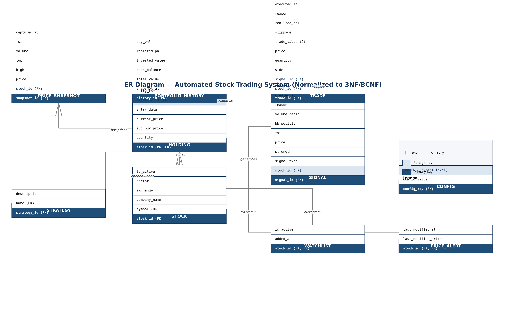

# Schema Documentation — Automated Stock Trading System

Companion to `schema.sql` and `er_diagram.md`. Target audience: DBMS course evaluation (report + viva).

---

## 1. Overview

The database supports a **paper-trading engine** that:
1. watches a list of stocks,
2. computes technical indicators (RSI, Bollinger Bands, MACD, volume ratio) via TA-Lib,
3. records **signals** (BUY/SELL/EXIT recommendations),
4. executes **trades** against simulated capital,
5. maintains open **holdings** with P&L,
6. stores **price snapshots** and **portfolio history** for analytics.

**DBMS:** SQLite 3.31+ (portable; porting notes in §7).
**Normalization target:** Third Normal Form (3NF) — BCNF actually holds (§5.4).

---

## 2. ER Diagram



*Figure 1 — ER diagram of the normalized schema. Also available as vector `er_diagram.svg` for print-quality report embedding.*

See `er_diagram.md` for the full relationship narrative — 10 entities, 8 meaningful relationships, STOCK as the hub entity.

---

## 3. Data Dictionary

Conventions: **PK** = primary key, **FK** = foreign key, **UK** = unique key, **NN** = NOT NULL, **G** = generated column. Monetary values in ₹ (REAL). Timestamps are ISO-8601 TEXT.

### 3.1 `strategy` — trading strategies (lookup)

| Column | Type | Constraints | Description |
|---|---|---|---|
| strategy_id | INTEGER | PK, AUTOINCREMENT | Surrogate key |
| name | TEXT | NN, UK | e.g. `RSI_BB`, `MACD_X`, `MANUAL` |
| description | TEXT | NN, default '' | Human description |

### 3.2 `stock` — master list of securities

| Column | Type | Constraints | Description |
|---|---|---|---|
| stock_id | INTEGER | PK, AUTOINCREMENT | Surrogate key |
| symbol | TEXT | NN, UK | Ticker with exchange suffix, e.g. `RELIANCE.NS` |
| company_name | TEXT | NN, default '' | Display name |
| exchange | TEXT | NN, default 'NSE' | NSE / BSE / ... |
| sector | TEXT | nullable | Sector may be unknown |
| is_active | INTEGER | NN, default 1, CHECK (0/1) | Soft-disable flag |

### 3.3 `watchlist` — monitored stocks (subset of STOCK)

| Column | Type | Constraints | Description |
|---|---|---|---|
| stock_id | INTEGER | PK, FK → stock(stock_id) ON DELETE CASCADE | 1:1 with stock; membership = identity |
| added_at | TEXT | NN, default now | When tracking began |
| is_active | INTEGER | NN, default 1, CHECK (0/1) | Temporarily paused monitoring |

### 3.4 `config` — engine parameters (key–value store)

| Column | Type | Constraints | Description |
|---|---|---|---|
| config_key | TEXT | PK | e.g. `initial_capital`, `max_positions` |
| config_value | TEXT | NN | Stored as TEXT; application casts (e.g. `float()`) |

> ⚠️ **Security note for the report:** the legacy `config` table stored the SMTP email password in **plaintext**. The normalized schema excludes credentials from the database — they belong in environment variables. Document this as a flaw found and fixed.

Important keys: `initial_capital` (simulated starting capital ₹), `current_cash` (uninvested cash), `max_position_pct` (max % of capital per position), `stop_loss_pct` / `take_profit_pct` (risk thresholds), `max_positions` (concurrency limit).

> Note: CONFIG has **no FK relationships** — it holds system-level, entity-less facts. Forcing one would create artificial entities.

### 3.5 `signal` — strategy outputs

| Column | Type | Constraints | Description |
|---|---|---|---|
| signal_id | INTEGER | PK, AUTOINCREMENT | Surrogate key |
| stock_id | INTEGER | NN, FK → stock(stock_id) ON DELETE CASCADE | Which stock |
| signal_type | TEXT | NN, CHECK IN ('BUY','SELL','EXIT') | Recommendation kind |
| strength | REAL | NN, default 0, CHECK 0–100 | Confidence score |
| price | REAL | NN, CHECK > 0 | Price when the signal fired |
| rsi | REAL | CHECK (NULL or 0–100) | RSI value (nullable) |
| bb_position | REAL | nullable | % position within Bollinger Bands |
| volume_ratio | REAL | CHECK (NULL or ≥ 0) | Volume ÷ 20-day average volume |
| reason | TEXT | NN, default '' | Human-readable rationale |
| created_at | TEXT | NN, default now | ISO-8601 |
| executed | INTEGER | NN, default 0, CHECK (0/1) | Set to 1 by trigger when a trade references this signal |

### 3.6 `trade` — executed orders

| Column | Type | Constraints | Description |
|---|---|---|---|
| trade_id | INTEGER | PK, AUTOINCREMENT | Surrogate key |
| stock_id | INTEGER | NN, FK → stock(stock_id) ON DELETE **RESTRICT** | RESTRICT: history must survive |
| signal_id | INTEGER | FK → signal(signal_id) ON DELETE **SET NULL** | Nullable: manual trades have no signal |
| side | TEXT | NN, CHECK IN ('BUY','SELL') | Order direction |
| quantity | INTEGER | NN, CHECK > 0 | Shares |
| price | REAL | NN, CHECK > 0 | Execution price |
| trade_value | REAL | **G:** `quantity * price`, STORED | Generated column — cannot drift from qty×price |
| slippage | REAL | NN, default 0, CHECK ≥ 0 | Simulated 0.1% slippage |
| realized_pnl | REAL | NN, default 0 | Only meaningful for SELL |
| realized_pnl_pct | REAL | NN, default 0 | — |
| reason | TEXT | NN, default '' | e.g. 'Stop-loss hit', 'Signal #12' |
| executed_at | TEXT | NN, default now | ISO-8601 |

### 3.7 `holding` — current open positions (1 per stock)

| Column | Type | Constraints | Description |
|---|---|---|---|
| stock_id | INTEGER | PK, FK → stock(stock_id) ON DELETE CASCADE | 1:1 with stock |
| quantity | INTEGER | NN, CHECK > 0 (also trigger-enforced) | Shares held |
| avg_buy_price | REAL | NN, CHECK > 0 | Volume-weighted average buy price |
| current_price | REAL | NN, default 0 | Live price cache (only deliberate denormalization — §5.3) |
| entry_date | TEXT | NN | First entry timestamp |
| strategy_id | INTEGER | FK → strategy(strategy_id) ON DELETE SET NULL | Which strategy opened it |
| entry_rsi | REAL | CHECK (NULL or 0–100) | RSI at entry (exit-signal input) |
| last_updated | TEXT | NN, default now | — |

### 3.8 `price_snapshot` — market price time series

| Column | Type | Constraints | Description |
|---|---|---|---|
| snapshot_id | INTEGER | PK, AUTOINCREMENT | Surrogate key |
| stock_id | INTEGER | NN, FK → stock(stock_id) ON DELETE CASCADE | Which stock |
| price | REAL | NN, CHECK > 0 | Last traded price |
| high | REAL | nullable | Day high |
| low | REAL | nullable | Day low |
| volume | INTEGER | CHECK (NULL or ≥ 0) | Day volume |
| rsi | REAL | CHECK (NULL or 0–100) | RSI cached at capture time |
| captured_at | TEXT | NN, default now | Time-series axis |

### 3.9 `portfolio_history` — portfolio value over time

| Column | Type | Constraints | Description |
|---|---|---|---|
| history_id | INTEGER | PK, AUTOINCREMENT | Surrogate key |
| snapshot_at | TEXT | NN | Time-series axis |
| total_value | REAL | NN | cash + invested + unrealized |
| cash_balance | REAL | NN, CHECK ≥ 0 | — |
| invested_value | REAL | NN | Cost basis of open positions |
| realized_pnl | REAL | NN, default 0 | Cumulative at snapshot time |
| day_pnl | REAL | NN, default 0 | — |
| *(removed columns)* | — | — | `unrealized_pnl`, `total_pnl`, `total_returns_pct` → derived in `vw_portfolio_history` (§5.3) |

### 3.10 `price_alert` — notification dedup state

| Column | Type | Constraints | Description |
|---|---|---|---|
| stock_id | INTEGER | PK, FK → stock(stock_id) ON DELETE CASCADE | One row per stock |
| last_notified_price | REAL | NN | — |
| last_notified_at | TEXT | NN | — |

---

## 4. Keys, Constraints and Integrity

| Integrity kind | Where implemented | Example |
|---|---|---|
| **Entity integrity** | PK on every table; AUTOINCREMENT surrogate keys; natural key `stock.symbol UNIQUE` | `stock(symbol)`, `config(config_key)` |
| **Referential integrity** | 8 FKs with deliberate ON DELETE actions | `trade.stock_id` RESTRICT (protect history), `signal.stock_id` CASCADE (signals die with stock), `trade.signal_id` SET NULL (manual trades survive) |
| **Domain integrity** | CHECK constraints | `side IN ('BUY','SELL')`, `rsi BETWEEN 0 AND 100`, `price > 0`, `quantity > 0`, `cash_balance >= 0` |
| **Business rules via triggers** | 4 triggers in schema.sql | signal auto-marked executed; holding.quantity must stay > 0 |
| **Business rules via generated columns** | `trade.trade_value` | qty×price computed by the DB engine, not app code |
| **Business rules via views** | 5 views | P&L, latest-signal, watchlist — §6 |

---

## 5. Normalization Walkthrough (for the report/viva)

### 5.1 First Normal Form (1NF) — atomic values, no repeating groups

**Violation found in the legacy schema:** the watchlist was a single CSV string (200+ symbols) inside `config`.
**Fix:** proper `stock` + `watchlist` tables. Each symbol is one row; membership queries become SQL `JOIN`s instead of string splitting.

### 5.2 Second Normal Form (2NF) — no partial dependency on part of a composite key

All tables use **single-column surrogate PKs** (or natural single-column PKs, e.g. `stock_id` in `holding`), so no composite keys exist. 2NF is satisfied trivially — say exactly that in the viva: *"single-attribute keys make partial dependencies impossible."*

### 5.3 Third Normal Form (3NF) — no transitive dependencies

**Violations found in the legacy schema and their fixes:**

| Legacy stored column | Why it violated 3NF | Normalized solution |
|---|---|---|
| `holdings.unrealized_pnl`, `unrealized_pnl_pct`, `current_value` | Derived from `current_price`, `avg_buy_price`, `quantity` (non-key → key dependency) | Computed in view `vw_holding_pnl` |
| `holdings.buy_value` | `quantity × avg_buy_price` | Dropped; derived |
| `trades.trade_value` | `quantity × price` | Generated column (engine-enforced) |
| `portfolio_history.unrealized_pnl`, `total_pnl`, `total_returns_pct` | Derived from cash + invested + initial_capital | Computed in `vw_portfolio_history` |
| `signals` table had no `stock_id` | Symbol stored as free text → update anomalies | FK to `stock` |
| `strategy` was a string column on holdings | Same strategy name repeated → anomaly-prone | Lookup table + FK |

**The one deliberate denormalization:** `holding.current_price` is a **live cache** refreshed by the engine every poll cycle. Storing it avoids recomputing 200+ API calls per dashboard refresh. It is a documented performance choice, not an accident — examiners appreciate that you can distinguish the two.

### 5.4 BCNF note

Every determinant is a candidate key (all PKs single-column; `stock.symbol` is UK). The schema is therefore in **BCNF** — mention it after 3NF; it scores points.

---

## 6. Views, Triggers, Indexes (advanced-features checklist)

### Views (5)

| View | Purpose | SQL concept demonstrated |
|---|---|---|
| `vw_holding_pnl` | Live P&L per open position | JOIN + arithmetic expressions |
| `vw_latest_signal` | Latest signal per stock | GROUP BY + MAX + self-JOIN subquery |
| `vw_portfolio_history` | Adds derived P&L columns | Projection of derived attributes |
| `vw_watchlist` | Active watchlist with details | JOIN + filtering |
| `vw_trade_performance` | Win rate, gross profit/loss | Conditional aggregation (CASE inside SUM) |

### Triggers (4)

| Trigger | Fires on | Rule enforced |
|---|---|---|
| `trg_trade_marks_signal_executed` | AFTER INSERT ON trade | Referenced signal marked executed — workflow integrity |
| `trg_holding_insert_positive_qty` | BEFORE INSERT ON holding | quantity > 0 (closed positions must be deleted) |
| `trg_holding_update_positive_qty` | BEFORE UPDATE OF quantity | Same rule on update |
| `trg_signal_updates_stock_state` | AFTER INSERT ON signal | SELL signals refresh alert state |

### Indexes (6)

| Index | Supports |
|---|---|
| `idx_signal_stock_time` | "Latest signal per stock" view |
| `idx_signal_executed` (partial) | Unexecuted-signal scan |
| `idx_trade_stock_time` | Per-stock trade history |
| `idx_trade_side` | BUY/SELL aggregates |
| `idx_price_snapshot_stock` | Time-series range queries |
| `idx_watchlist_active` (partial) | Active watchlist scan |

---

## 7. Porting Notes (if your college mandates MySQL/PostgreSQL)

| SQLite (this schema) | MySQL 8 | PostgreSQL 14+ |
|---|---|---|
| TEXT timestamps (ISO-8601) | `DATETIME DEFAULT CURRENT_TIMESTAMP` | `TIMESTAMPTZ DEFAULT now()` |
| `INTEGER AUTOINCREMENT` | `INT AUTO_INCREMENT` | `GENERATED ALWAYS AS IDENTITY` |
| `GENERATED ALWAYS AS ... STORED` | Same syntax (5.7+) | Same syntax |
| Partial indexes (`WHERE executed = 0`) | ❌ not supported → full index | ✅ supported |
| Trigger dialect | `DELIMITER` + `BEGIN...END` | PL/pgSQL function + trigger |
| `PRAGMA foreign_keys` | Always on | Always on |

---

## 8. Sample Queries for the Report

```sql
-- Q1. Current portfolio value and holdings value (scalar subqueries)
SELECT  (SELECT config_value FROM config WHERE config_key = 'initial_capital') AS initial_capital,
        (SELECT CAST(config_value AS REAL) FROM config WHERE config_key = 'current_cash') AS cash,
        (SELECT COALESCE(SUM(current_price * quantity), 0) FROM holding) AS holdings_value,
        (SELECT CAST(config_value AS REAL) FROM config WHERE config_key = 'current_cash')
          + (SELECT COALESCE(SUM(current_price * quantity), 0) FROM holding) AS total_value;

-- Q2. Win rate and P&L breakdown (uses the vw_trade_performance view)
SELECT total_trades,
       winning_trades,
       ROUND(100.0 * winning_trades / NULLIF(total_trades, 0), 2) AS win_rate_pct,
       gross_profit,
       gross_loss,
       net_realized_pnl
FROM vw_trade_performance;

-- Q3. Latest signal per stock (classic GROUP BY / MAX join)
SELECT * FROM vw_latest_signal;

-- Q4. Stocks whose latest signal is an unexecuted BUY
SELECT s.symbol, si.signal_type, si.strength, si.price, si.created_at
FROM vw_latest_signal si
JOIN stock s ON s.stock_id = si.stock_id
WHERE si.executed = 0 AND si.signal_type = 'BUY';

-- Q5. Unrealized P&L leaderboard
SELECT symbol, quantity, avg_buy_price, current_price,
       unrealized_pnl, unrealized_pnl_pct
FROM vw_holding_pnl
ORDER BY unrealized_pnl DESC;

-- Q6. Portfolio value trend, last 30 snapshots
SELECT snapshot_at, total_value, cash_balance,
       total_value - cash_balance - invested_value AS unrealized_pnl,
       (total_value - cash_balance - invested_value) + realized_pnl AS total_pnl
FROM vw_portfolio_history
ORDER BY snapshot_at DESC
LIMIT 30;

-- Q7. Trades joined to their signals (why each trade happened)
SELECT t.trade_id, s.symbol, t.side, t.quantity, t.price,
       t.realized_pnl, si.signal_type, si.reason AS signal_reason, t.reason
FROM trade t
JOIN signal si ON si.signal_id = t.signal_id
JOIN stock s   ON s.stock_id = t.stock_id
ORDER BY t.executed_at DESC
LIMIT 50;

-- Q8. Price range analysis per stock (aggregation over time series)
SELECT s.symbol,
       COUNT(*)                AS snapshots,
       MIN(ps.price)           AS min_price,
       MAX(ps.price)           AS max_price,
       ROUND(AVG(ps.price), 2) AS avg_price,
       ROUND(100.0 * (MAX(ps.price) - MIN(ps.price)) / MIN(ps.price), 2) AS range_pct
FROM price_snapshot ps
JOIN stock s ON s.stock_id = ps.stock_id
GROUP BY s.symbol;

-- Q9. Watchlist stocks with no open position (buy candidates)
SELECT s.symbol
FROM vw_watchlist s
LEFT JOIN holding h ON h.stock_id = s.stock_id
WHERE h.stock_id IS NULL;

-- Q10. Daily trade activity and realized P&L (GROUP BY date)
SELECT DATE(executed_at) AS trade_date,
       COUNT(*)          AS trades,
       SUM(CASE WHEN side='SELL' THEN realized_pnl ELSE 0 END) AS realized_that_day,
       SUM(CASE WHEN side='BUY'  THEN trade_value  ELSE 0 END) AS bought_value
FROM trade
GROUP BY DATE(executed_at)
ORDER BY trade_date DESC;
```

---

## 9. Suggested Report Structure (maps to a typical DBMS rubric)

| Report section | Where to get it |
|---|---|
| Introduction & objectives | §1 here + application README |
| ER diagram | `er_diagram.md` (export the Mermaid block as PNG) |
| Relational schema (DDL) | `schema.sql` §1 |
| Normalization (1NF → BCNF) | §5 here |
| Keys & integrity constraints | §4 here |
| Views / triggers / indexes | `schema.sql` §2–4 + §6 here |
| Sample SQL queries | §8 (Q1–Q10) |
| Screenshots / demo | Run `dashboard.py` (Streamlit) or Android app + `api_server.py` |
| Future scope | MySQL port (§7), live broker API, user accounts / roles table |

---

*Generated for DBMS coursework from the actual application schema. Legacy-design flaws were corrected and documented rather than hidden — presenting the before/after is itself a normalization case study.*
